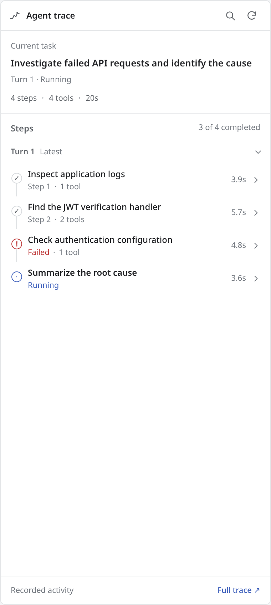
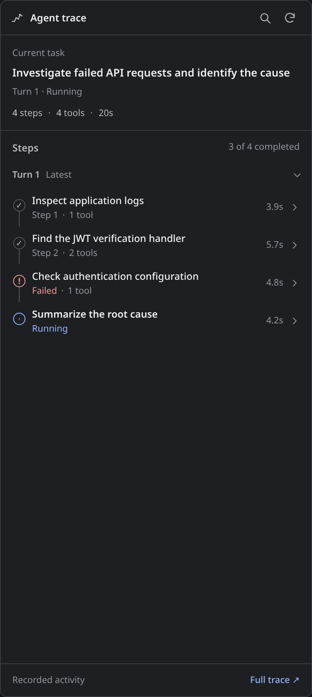
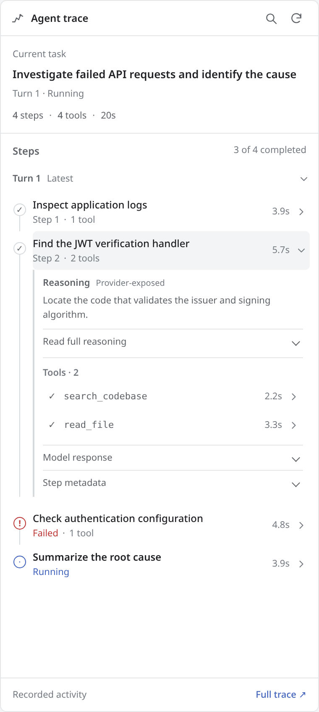
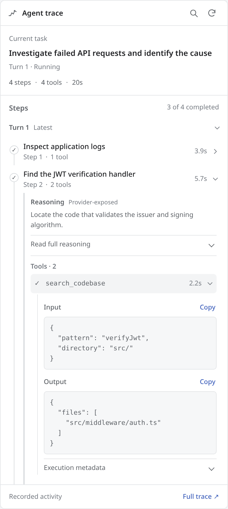

# DSH Trace Studio

A **small, live trace sidebar** for [DeepSeek Harness (DSH)](https://github.com/deepseek-ai/deepseek-harness). See what your agent is doing without opening a full observability dashboard. Expand only the steps that interest you to inspect available model reasoning, tool inputs and outputs, errors, usage, and metadata.

> **Status:** v0.3.1 developer preview. The collector and UI demo have been tested locally. **DSH runtime integration has not yet been verified against a live installation.**

## Minimal sidebar, matched to the DSH theme

| DSH-style light preview | DSH-style dark preview |
|---|---|
|  |  |

Previews use **synthetic activity** and approximate the DSH color palette. When installed in DSH Web, the panel uses the host's **actual semantic `--dsw-*` theme variables**, not these demo colors.



The right sidebar shows **task title → compact step timeline → expandable details**. Earlier turns collapse automatically; the current turn remains visible. The new design uses DSH text styles, native background/borders, Material-inspired spacing, unobtrusive dividers, and flat rows instead of decorative cards, saturated badges, and custom palettes.

**Color and theme:** `lib/sidebar.css` references DSH semantic tokens such as `--dsw-alias-bg-base`, `--dsw-alias-label-secondary`, `--dsw-alias-border-l2`, `--dsw-alias-interactive-bg-hover`, and the business/error/warn/success state tokens. CSS variables do not cross an iframe boundary, so `lib/client.js` copies the computed host tokens into the embedded sidebar on load and when DSH's theme changes (including dark/light). Fallback colors are neutral, for the demo or unexpected older DSH versions. This is *Material-inspired*; it does not add the MUI React library or a separate design system.

For details, follow the progressive disclosure path:

1. **Click a step** to see the provider-exposed reasoning excerpt and tools used.
2. **Click a tool** for the precise input, output, error (if any), and execution metadata.
3. **Expand “Read full reasoning,” “Model response,” or “Step metadata”** for the rest of the recorded details.
4. **Full explorer ↗** opens the existing, more advanced timeline and flow-graph interface in another tab when you need it.



All screenshots use synthetic data, not private sessions or a production DSH run.

## Try the interface first

You can open the demo without DSH. Serve the repository root on localhost:

```bash
python3 -m http.server 8765
# Navigate to http://127.0.0.1:8765/demo/sidebar.html
```

The original, full trace interface is at `/demo/index.html`. The standalone preview does not add a Demo badge to the sidebar. The preview page includes Light/Dark toggles and supports clicking through steps and tools, inspecting metadata, filtering, and keyboard navigation. No server credentials or API keys are required. The demo is populated with synthetic agent activity.

## Install into DSH

```bash
# Clone the project somewhere accessible to the DSH process
# Link the plugin into the web profile
 dsh plugin --profile web add link:/absolute/path/to/dsh-trace-studio

# Restart `dsh web` and hard-refresh the browser.
```

Open a conversation and click **Agent trace** in the right sidebar or use the new session-header icon. The sidebar is now the default plugin view. To see it on its own, open:

```text
http://localhost:3080/trace-studio/sidebar?session=<DSH-session-id>
```

The **Full explorer** link opens `/trace-studio/view?session=<id>` (unchanged from v0.1). DSH must expose `webServer`, `sessionPersistence` (for history), `agent/assistant-stream`, `session/event`, and Web slots. The installer expects Node.js 20 or later. You may need to adjust registration for a different DSH version.

## What gets recorded?

The plugin listens to DSH event streams and projects them into the hierarchy **session → turn → model step → tool calls**:

| UI field | DSH data source |
|---|---|
| Start/end time and status | `turn/start`, `turn/end`, `step/start`, `step/end` |
| Model response and exposed reasoning | `assistant/message`, `reasoning-delta`, `text-delta` |
| Tool name and input | `tool/call` |
| Tool output and failure | `tool/result`; `message.isError` is authoritative |
| Model identity and token usage | `assistant/message`, only where provided |
| Past traces | Read-only `sessionPersistence`, where available |

**Important:** This plugin shows only *observable execution facts* and **reasoning actually exposed by the model provider**. It cannot read a model's private chain of thought. A recorded tool call shows what happened, not proof of hidden intent.

## Architecture

```text
DSH agent stream + session events
              │
              ▼
   Read-only event collector ──── optional historical replay
       (lib/collector.js)         (sessionPersistence)
              │
              ▼
       DSH WebServer APIs
       /trace-studio/api/trace
       /trace-studio/api/stream  (SSE)
              │
       ┌──────┴─────────┐
       ▼                ▼
Compact sidebar    Full explorer
(default iframe)   (optional full-page)
```

`lib/client.js` registers the DSH sidebar tab and bridges host theme tokens into its same-origin iframe. `lib/sidebar.js` and `lib/sidebar.css` implement the minimal, accessible view without a frontend build step. The existing `lib/viewer.js` still provides the advanced timeline/graph explorer. The viewer uses no third-party web CDN or telemetry.

## Development and validation

```bash
npm run check
npm test
npm run pack:dry
```

Automated Node tests cover event reconstruction, errors, redaction, and route registration. Optional browser checks use Playwright for step/tool expansion, light/dark UI, search, narrow-width overflow, and a **simulated DSH host theme switch propagated to the iframe**:

```bash
# Optional: Python Playwright + Chromium are required
python scripts/verify-ui.py
```

Screenshots are generated with synthetic traces. **Actual DSH integration and visual alignment against a running DSH installation are still unverified**; the theme bridge was checked against a simulated host.

### Security and limitations

- **Run only on a trusted local/private DSH Web endpoint.** Trace data may contain sensitive prompts, file paths, request data, and credentials. The routes rely on the security boundary of the host DSH web server.
- The collector redacts common tokens and credential fields; this is not comprehensive data-loss prevention. Inspect sensitive output before copying or exporting.
- Collected state is in memory, with read-only historical reconstruction when supported. No external telemetry, cloud database, or AI title-generation calls are made.
- SSE currently sends throttled **full snapshots**. For very long sessions, incremental updates and virtualization would improve performance.
- The old flow graph remains an optional, advanced view. It represents recorded execution relationships, not proven model reasoning.
- DSH's plugin/slot APIs are version-sensitive and this release has not been integration-tested against a live DSH instance.

## References and license

- [DeepSeek Harness](https://github.com/deepseek-ai/deepseek-harness) — MIT.
- [Think Flow](https://github.com/yfwu2020/dsh-think-flow) — MIT. Used as a reference for public DSH event and slot integration patterns; no UI or code was copied.
- [LangSmith](https://docs.smith.langchain.com/) — inspiration for nested trace metadata exploration; this plugin is not affiliated with LangChain.

MIT licensed. See [LICENSE](LICENSE).
